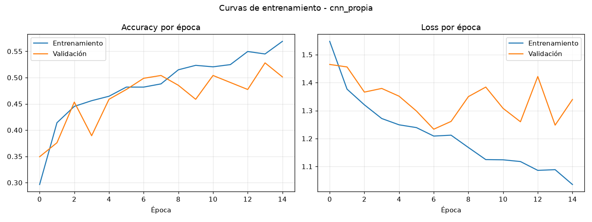
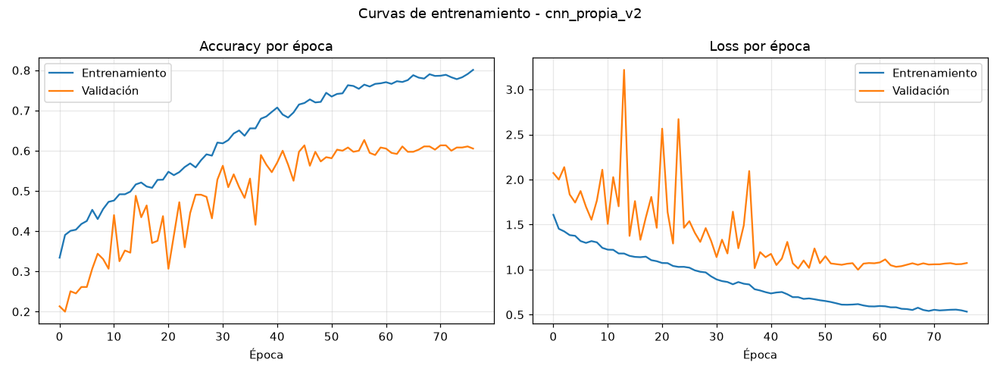
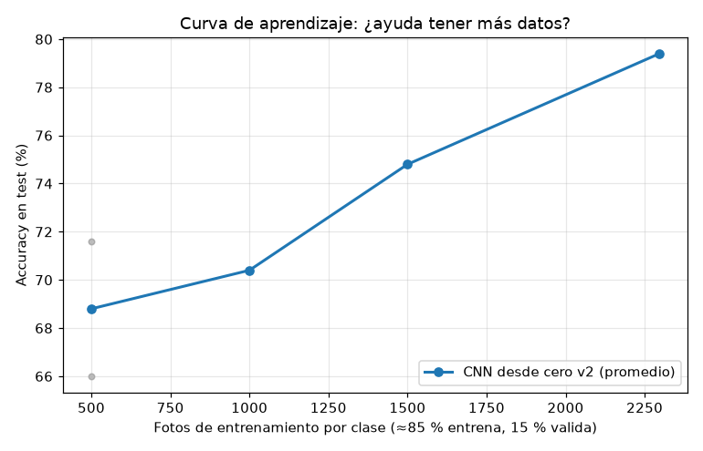
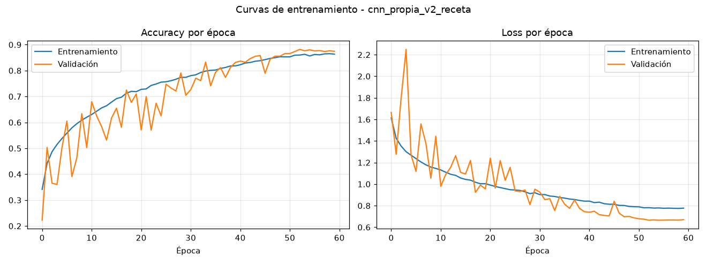
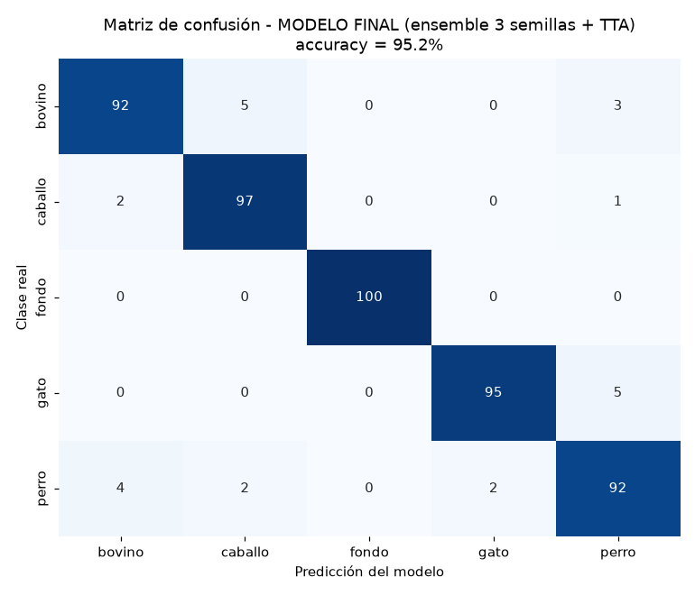

# Proyecto 6 – Detección de animales en vías y zonas rurales
## Documentación del entrenamiento de la CNN (fase 1: clasificar animales en fotos)

> Este documento explica **qué se hizo, en qué orden, con qué herramientas y por qué**.
> Está pensado para estudiar antes de la sustentación: cada paso tiene la decisión que se tomó
> y la justificación. Al final hay preguntas probables del profesor con su respuesta.
>
> **Restricción del proyecto:** no se usan modelos preentrenados. Todas las redes de este
> documento se diseñaron y entrenaron **desde cero** (pesos aleatorios) con nuestros datos.

**Resultado final:** una CNN propia (ensemble de 3 redes + TTA) que identifica **bovino, caballo,
gato, perro o fondo (sin animal)** con **95.2 % de acierto** en 500 fotos de test nunca vistas.
El primer intento sacaba 58.8 %.

**Qué es exactamente el modelo final:** `modelos/modelo_final.json` + las 3 redes
`modelos/cnn_propia_v2_receta.keras`, `cnn_propia_v2_receta_s1.keras` y `cnn_propia_v2_receta_s2.keras`.
Las 3 tienen la misma arquitectura (CNN v2: 4 bloques Conv-BN-ReLU ×2 + MaxPool, GlobalAveragePooling,
Dropout, Dense de 5; 1.18 M de parámetros), se entrenaron desde cero con el mismo dataset
(27 202 fotos, 224 px) y solo cambia la semilla. Para cada foto se promedian las probabilidades de
las 3 redes sobre la foto normal y en espejo (6 pasadas).

**Cómo está organizado el repositorio:**
- `src/` tiene **solo el pipeline del modelo final**, pasos 1 a 5: armar el dataset (1 y 2),
  entrenar (3), combinar las 3 semillas (4) y evaluar (5).
- `historial/` guarda los **experimentos previos E1 a E4** (exploración, CNN v1, CNN v2, curva de
  aprendizaje): no forman parte del modelo final, pero son la evidencia de cada decisión.

---

## Índice
0. [Cómo ejecutar todo](#0-cómo-ejecutar-todo)
1. [El problema y el alcance de esta fase](#1-el-problema-y-el-alcance-de-esta-fase)
2. [Herramientas utilizadas](#2-herramientas-utilizadas)
3. [Estructura del proyecto](#3-estructura-del-proyecto)
4. [El dataset (experimento E1)](#4-el-dataset-experimento-e1)
5. [Preprocesamiento y aumento de datos](#5-preprocesamiento-y-aumento-de-datos)
6. [Experimento E2 – CNN v1 (primer intento)](#6-experimento-e2--cnn-v1-primer-intento)
7. [Experimento E3 – CNN v2 (mejor arquitectura, en GPU)](#7-experimento-e3--cnn-v2-mejor-arquitectura-en-gpu)
8. [Paso 1 y experimento E4 – Más datos y curva de aprendizaje](#8-paso-1-y-experimento-e4--más-datos-y-curva-de-aprendizaje)
9. [Paso 2 – Dataset al máximo](#9-paso-2--dataset-al-máximo)
10. [Paso 3 – Receta moderna de entrenamiento (224 px)](#10-paso-3--receta-moderna-de-entrenamiento-224-px)
11. [Paso 4 – Ensemble + TTA: el modelo final](#11-paso-4--ensemble--tta-el-modelo-final)
12. [Paso 5 – Evaluación final y comparación](#12-paso-5--evaluación-final-y-comparación)
13. [Usar el modelo: identificar el animal en una foto](#13-usar-el-modelo-identificar-el-animal-en-una-foto)
14. [Cómo continuar: llevarlo a cámara / video](#14-cómo-continuar-llevarlo-a-cámara--video)
15. [Limitaciones conocidas](#15-limitaciones-conocidas)
16. [Preguntas probables en la sustentación](#16-preguntas-probables-en-la-sustentación)
17. [Glosario](#17-glosario)
18. [Fuentes](#18-fuentes)

---

## 0. Cómo ejecutar todo

Desde la carpeta del proyecto, en PowerShell:

```powershell
# (solo la primera vez) crear el entorno e instalar librerías
uv venv --python 3.12 .venv
uv pip install --python .venv\Scripts\python.exe -r requirements.txt

# demo: identificar el animal en una foto o en una carpeta de fotos
.venv\Scripts\python.exe src\predecir.py fotos_prueba
.venv\Scripts\python.exe src\predecir.py fotos_prueba --rapido      # modo rápido (1 modelo)
```

Para **reentrenar el modelo final** desde cero (el paso 3 usa la GPU):

```powershell
.venv\Scripts\python.exe src\paso1_ampliar_dataset.py          # descarga ~9 000 recortes (~5 min)
.venv\Scripts\python.exe src\paso2_ampliar_al_maximo.py        # descarga ~15 700 recortes (~9 min)
.venv\Scripts\python.exe src\paso3_entrenar_cnn.py             # semilla 42, ~75 min en GPU
$env:SEMILLA = "1"; .venv\Scripts\python.exe src\paso3_entrenar_cnn.py
$env:SEMILLA = "2"; .venv\Scripts\python.exe src\paso3_entrenar_cnn.py
Remove-Item Env:SEMILLA
.venv\Scripts\python.exe src\paso4_ensemble_tta.py             # arma el modelo final
.venv\Scripts\python.exe src\paso5_evaluar.py                  # métricas, matriz de confusión, errores
```

Si los modelos ya están en `modelos/`, **solo hace falta `predecir.py`** para la demo.
Los experimentos previos (E1–E4) se corren desde `historial/src/` (ver `historial/LEEME.md`).

---

### Bitácora: qué se hizo, en orden

**E** = experimento previo (carpeta `historial/`). **Paso** = parte del pipeline final (carpeta `src/`).

| # | Qué se hizo | Resultado / decisión |
|---|---|---|
| 1 | Se leyó el enunciado (Proyecto 6) y la clase 8 de CNN | Fase 1 = clasificar especies con una CNN en Keras, como en clase |
| 2 | Se preparó el entorno | Python 3.14 no soporta TensorFlow → entorno `.venv` con Python 3.12 + TensorFlow 2.19 / Keras 3 |
| 3 | E1: exploración del dataset | 5 clases × 500 (train) y × 100 (test); recortes de Open Images de tamaño variable → 160×160 |
| 4 | E2: **CNN v1** (Conv → MaxPool → Flatten → Dense, como en MNIST) | **58.8 %** en test. Al revisar el log: no había terminado de aprender (accuracy de entrenamiento 57 %) |
| 5 | GPU: Keras 3 con backend **PyTorch** (TensorFlow no usa GPU en Windows) | Primera prueba lenta (34 s/época, GPU al 20 %). Medido: el aumento de datos dentro del modelo era el cuello de botella → se movió a `tf.data` → **6 s/época** |
| 6 | E3: **CNN v2** (BatchNorm, 2 conv por bloque, GlobalAveragePooling, 150 épocas máx.) | **68.8 % ± 2.8** (3 semillas). Ahora sí sobreajusta: le faltan datos |
| 7 | **Paso 1**: más recortes de Open Images (misma fuente y reglas) | De 500 a **~2 300 fotos por clase** |
| 8 | E4: curva de aprendizaje (500 → 1 000 → 1 500 → 2 300 por clase) | 68.8 → 70.4 → 74.8 → **79.4 %**. La curva no se aplana: más datos sigue ayudando |
| 9 | Búsqueda de estrategias para entrenar desde cero (literatura) | Plan: receta moderna (AdamW, coseno, label smoothing, MixUp/CutMix), 224 px, ensemble + TTA, máximo de datos |
| 10 | **Paso 2**: dataset al máximo (Open Images train + test, se agrega "Bull" a bovino) | **27 202 fotos** (bovino 3 261, resto ~6 000). Bovino es el límite |
| 11 | **Paso 3**: receta moderna. Primer intento lento (RandAugment de Keras = 2.4 s por lote) | Se escribió un aumento vectorizado **16x más rápido** → 85 s por época |
| 12 | **Paso 3**: 3 semillas, una a la vez con la GPU dedicada | **93.1 % ± 1.2** (92.8 / 92.0 / 94.4) |
| 13 | **Paso 4**: ensemble de 3 + TTA, elegido **por validación** | **95.2 %** en test. Modo rápido (1 modelo) para tiempo real |
| 14 | **Paso 5**: evaluación, análisis de errores, umbral, velocidad | ~6 de los 24 errores son etiquetas malas del test; 18 de 24 tienen confianza < 60 % |
| 15 | Limpieza del repositorio | `src/` queda solo con los 5 pasos del modelo final; los experimentos E1–E4 (scripts, modelos, logs) pasan a `historial/` |

---

## 1. El problema y el alcance de esta fase

**Enunciado (Proyecto 6):** desarrollar un sistema que detecte animales en carreteras y zonas
rurales para prevenir accidentes.

| Requisito del enunciado | Estado |
|---|---|
| Clasificar especies: perros, gatos, vacas, caballos u otros | ✅ **Hecho en esta fase** (CNN propia) |
| Detectar animales en videos | 🔜 Siguiente fase (ver sección 14) |
| Seguimiento (tracking) de los animales detectados | 🔜 Siguiente fase |
| Alertas cuando aparezcan en zonas de circulación | 🔜 Siguiente fase |
| Asistente (transformer) para consultar los animales identificados | 🔜 Siguiente fase |

**Qué resuelve esta fase:** le pasamos una foto al modelo y responde qué hay en ella:
`bovino`, `caballo`, `gato`, `perro` o `fondo` (no hay animal), con la probabilidad de cada una.

**Por qué empezar por clasificación:** todo el sistema de video depende de un "cerebro" que sepa
reconocer la especie. Con el clasificador listo, la cámara solo tiene que encontrar *dónde* hay
algo que se mueve, recortar esa zona y preguntarle al clasificador *qué es*. Por eso el modelo
quedó empaquetado en un módulo reutilizable (`src/clasificador.py`).

**Tipo de problema:** clasificación **multiclase** (5 clases, una respuesta por imagen),
aprendizaje **supervisado** (cada imagen tiene su etiqueta).

---

## 2. Herramientas utilizadas

| Herramienta | Para qué | Por qué esa |
|---|---|---|
| **Python 3.12** | Lenguaje | TensorFlow aún no soporta Python 3.14 (el instalado en el PC) |
| **uv** + entorno `.venv` | Aislar las librerías del proyecto | Cualquiera lo reproduce con `requirements.txt` |
| **TensorFlow 2.19 / Keras 3** | Construir y entrenar la CNN; cargar las imágenes (`tf.data`) | Framework visto en clase (notebooks de MNIST y MLP) |
| **PyTorch 2.11 (CUDA 12.8)** como *backend* de Keras | Entrenar en la **GPU RTX 5070** | TensorFlow no usa GPU en Windows desde la versión 2.10. Keras 3 puede ejecutar el **mismo código** sobre TensorFlow, PyTorch o JAX (variable `KERAS_BACKEND`). PyTorch sí usa la GPU en Windows; CUDA 12.8 es la versión que soporta la serie RTX 50 |
| **pandas** | Leer las anotaciones de Open Images (CSV de 2.2 GB) | Filtrar millones de cajas por clase |
| **scikit-learn** | `classification_report`, `confusion_matrix` | Igual que en el notebook de MLP de clase |
| **matplotlib / seaborn** | Gráficas (curvas, matrices, mosaicos) | Igual que en clase |
| **Pillow (PIL)** | Leer imágenes, recortar cajas | Liviano |
| **OpenCV** | (Instalado para la siguiente fase) cámara y video | Visto en el taller de OpenCV |

**Hardware:** CPU para la v1; **GPU RTX 5070** desde la v2. Los modelos `.keras` son
intercambiables entre motores: lo entrenado con PyTorch en la GPU se carga con TensorFlow en la
CPU (así lo usan `clasificador.py` y la cámara).

---

## 3. Estructura del proyecto

```
cnn-proyecto-final/
├── src/                          ← SOLO el pipeline del modelo final
│   ├── comun.py                  configuración compartida (rutas, clases, carga de datos, aumento)
│   ├── paso1_ampliar_dataset.py  descarga más recortes de Open Images (~2 300/clase)
│   ├── paso2_ampliar_al_maximo.py  todos los recortes disponibles (27 202 fotos)
│   ├── paso3_entrenar_cnn.py     CNN v2 + receta moderna, 224 px, GPU (se corre con 3 semillas)
│   ├── paso4_ensemble_tta.py     combina las 3 semillas + TTA → modelo final
│   ├── paso5_evaluar.py          métricas, matriz de confusión y errores del modelo final
│   ├── clasificador.py           MÓDULO REUTILIZABLE (para la cámara)
│   └── predecir.py               demo: clasificar fotos desde la terminal
├── modelos/
│   ├── modelo_final.json         ← MODELO FINAL (dice qué redes usar, 224 px y TTA)
│   └── cnn_propia_v2_receta[_s1|_s2].keras + .json   ← las 3 redes del modelo final
├── resultados/                   ← logs, curvas, matrices de confusión y errores del pipeline final
│   └── predicciones/             ← salida de la demo
├── data/
│   ├── dataset_cnn/              ← dataset ORIGINAL (500/clase train, 100/clase test). No se modifica
│   ├── dataset_cnn_ampliado/     ← paso 1: ~2 300/clase (mismo test)
│   ├── dataset_cnn_maximo/       ← paso 2: 27 202 fotos (mismo test) → con este se entrena el final
│   └── anotaciones_open_images/  ← CSV de Open Images (cajas, clases; incluye el de train de 2.2 GB)
├── historial/                    ← EXPERIMENTOS PREVIOS E1–E4 (no los usa el modelo final)
│   ├── src/                      exp1_explorar_datos, exp2_entrenar_cnn_v1, exp3_entrenar_cnn_v2,
│   │                             exp4_curva_aprendizaje (+ copia del comun.py de entonces)
│   ├── modelos/                  CNN v1, CNN v2 (3 semillas), v2 ampliado, v2 n1000 / n1500
│   ├── resultados/               sus logs, curvas y la comparación de todos los modelos
│   └── data/                     subconjuntos de 1 000 y 1 500 fotos/clase (hard links)
├── fotos_prueba/                 ← fotos para la demo (pon aquí tus propias fotos)
├── docs/DOCUMENTACION.md         (este archivo)
└── requirements.txt
```

**Decisión de diseño:** todo lo que comparten los scripts (rutas, clases, cómo se cargan los
datos, el aumento de datos) está en `comun.py`. Cada modelo guarda junto a él un `.json` con sus
clases y su tamaño de imagen; así es imposible entrenar con 224 px y predecir con otro tamaño.

---

## 4. El dataset (experimento E1)

**Script:** `historial/src/exp1_explorar_datos.py` → `historial/resultados/exp1_*.png` y `exp1_resumen.txt`.

### 4.1 Origen
- Las imágenes vienen de **Open Images V7** (Google): millones de fotos anotadas con **cajas
  delimitadoras** (bounding boxes) revisadas por personas.
- El dataset no son fotos completas sino **recortes**: de cada foto se toma la caja donde está el
  animal y se guarda solo esa región. Los archivos `manifest_*.csv` registran de qué foto y de qué
  caja sale cada recorte.
- Train y test vienen de **particiones distintas** de Open Images (fotos distintas), así no hay
  "trampa" (la misma foto en entrenamiento y en prueba).
- Reglas: cajas de **un** animal (no grupos), fotos reales (no dibujos), etiqueta verificada,
  máximo un recorte por clase por foto.

### 4.2 Clases
| Clase | Qué contiene |
|---|---|
| `bovino` | vacas, toros |
| `caballo` | caballos |
| `gato` | gatos |
| `perro` | perros |
| `fondo` | **no hay animal**: recortes de autos y camiones en fotos sin animales |

**¿Por qué existe la clase `fondo`?** En la cámara real no siempre habrá un animal. Si el modelo
solo conociera 4 clases, ante un carro respondería obligatoriamente "perro" o "vaca" (softmax
siempre reparte el 100 % entre las clases que conoce). Con `fondo` puede decir "aquí no hay
animal" y evitar falsas alarmas.

### 4.3 Lo que encontramos al explorar
- **Balanceado:** 500 imágenes por clase en train y 100 por clase en test. La *accuracy* es una
  métrica confiable (ninguna clase domina).
- **Tamaños variables:** de 29 a 384 px de ancho (mediana 367). 44 imágenes tienen algún lado
  menor de 64 px. La CNN necesita entradas del mismo tamaño → se redimensionan todas.
- Hay ejemplos difíciles: animales tapados, en blanco y negro, de noche, con jinetes encima.
- **Ruido en las etiquetas:** en el análisis de errores aparecieron cabras, ovejas y un órice
  etiquetados como `bovino`, y lobos como `perro`. Es normal en datasets grandes etiquetados por
  personas (ver 12.4).

### 4.4 División de los datos (train / validación / test)
| Conjunto | Origen | Para qué |
|---|---|---|
| **Entrenamiento** | 85 % de la carpeta `train/` | El modelo ajusta sus pesos con estas |
| **Validación** | 15 % de `train/` (semilla fija 42) | Vigilar el sobreajuste, guardar la mejor época, **elegir entre modelos** |
| **Test** | carpeta `val/` completa (500 fotos) | **Solo para medir**. Es la nota "honesta" |

**El test es el mismo en todo el proyecto**: las mismas 500 fotos, aunque el entrenamiento crezca
a 27 000. Así todas las comparaciones son justas. Nunca se usa para tomar decisiones.

**¿Por qué tres conjuntos y no dos?** La validación se usa para decidir (mejor época, mejor
modelo); al decidir con ella, queda "contaminada". El test nunca participa en ninguna decisión, por
eso su resultado estima cómo funcionará el modelo con fotos nuevas.

---

## 5. Preprocesamiento y aumento de datos

Todo está en `comun.py`.

### 5.1 Carga de imágenes
`image_dataset_from_directory` lee las carpetas y **la etiqueta es el nombre de la carpeta**:
`bovino=0, caballo=1, fondo=2, gato=3, perro=4` (orden alfabético).

- **Tamaño:** 160×160 en v1/v2; **224×224** en el modelo final (más detalle; ver 10.1).
  Interpolación bilineal.
- **Lote (batch):** 32 en v1/v2; 64 en el final.
- `cache()` guarda las imágenes en RAM; `prefetch()` prepara el siguiente lote mientras la GPU
  entrena el actual. Para el dataset grande el caché se guarda en **uint8** (0-255) en vez de
  float32: 4 veces menos memoria (~4 GB en vez de ~16 GB).

### 5.2 Normalización
Las redes aprenden mejor con números pequeños: `Rescaling(1/255)` lleva los píxeles a [0, 1]
(como en MNIST). **Va dentro del modelo** como una capa: quien lo use (por ejemplo, la cámara)
le entrega la imagen RGB normal (0-255) y no puede olvidar normalizar.

### 5.3 Aumento de datos (data augmentation)
Con pocas fotos el modelo **memoriza** (sobreajuste). La solución es mostrarle en cada época
versiones distintas de cada foto. No se generan archivos nuevos: se transforman "al vuelo".

**v1 y v2** (capas de Keras):

| Transformación | Valor | Justificación |
|---|---|---|
| `RandomFlip("horizontal")` | espejo | un perro mirando a la izquierda sigue siendo perro. *No* vertical: un animal patas arriba no es realista |
| `RandomRotation(0.08)` | ±≈29° | cámara inclinada, animal en pendiente |
| `RandomZoom(0.15)` | ±15 % | animal más cerca / más lejos |
| `RandomTranslation(0.1, 0.1)` | ±10 % | animal no centrado |
| `RandomContrast(0.2)` | ±20 % | iluminación distinta |

**Modelo final** (más fuerte, ver 10.1): una transformación afín aleatoria por foto (volteo,
rotación ±15°, zoom 0.8–1.25×, desplazamiento, inclinación) + color aleatorio (brillo, contraste,
saturación, 10 % en escala de grises) + **MixUp / CutMix**.

---

## 6. Experimento E2 – CNN v1 (primer intento)

**Script:** `historial/src/exp2_entrenar_cnn_v1.py` → `historial/modelos/cnn_propia.keras`

### 6.1 Arquitectura capa por capa
Es la estructura vista en la clase 8 y en el notebook de MNIST:

| # | Capa | Salida | Qué hace |
|---|---|---|---|
| – | Entrada + aumento + Rescaling 1/255 | 160×160×3 | Imagen RGB normalizada |
| 1 | Conv2D 32 filtros 3×3, ReLU | 160×160×32 | Patrones simples: bordes, colores |
| | MaxPooling 2×2 | 80×80×32 | Reduce a la mitad, se queda con el valor más fuerte |
| 2 | Conv2D 64, ReLU + MaxPool | 40×40×64 | Texturas (pelaje, manchas) |
| 3 | Conv2D 128, ReLU + MaxPool | 20×20×128 | Partes: orejas, ojos, patas, hocico |
| 4 | Conv2D 128, ReLU + MaxPool | 10×10×128 | Formas más completas |
| – | Flatten | 12 800 | Aplana los mapas en un vector |
| – | Dropout 0.5 | 12 800 | Apaga 50 % de neuronas al azar al entrenar |
| – | Dense 128, ReLU | 128 | Combina las características |
| – | Dense 5, **softmax** | 5 | Probabilidad de cada clase (suman 1) |

Conceptos (clase 8):
- **Convolución:** un filtro 3×3 se desliza por la imagen; en cada posición multiplica y suma.
  Los valores del filtro **no se definen a mano: la red los aprende**. `padding="same"` mantiene
  el tamaño.
- **Más filtros en capas profundas (32→64→128):** la imagen se achica, pero los patrones son más
  complejos y se necesitan más filtros para representarlos.
- **ReLU:** convierte los negativos en 0; da no-linealidad.
- **MaxPooling 2×2:** se queda con el máximo de cada bloque 2×2 → mitad de tamaño, menos
  cálculo, tolerancia a pequeños desplazamientos.
- **Softmax:** convierte los "logits" en probabilidades: P(i) = e^zᵢ / Σ e^zⱼ.
- **Dropout:** contra el sobreajuste; la red no puede depender de pocas neuronas.

### 6.2 Compilación y callbacks
- **Adam** (learning rate 0.001): descenso del gradiente con paso adaptativo por peso.
- **Pérdida `sparse_categorical_crossentropy`:** loss = −log(P(clase real)). Si el modelo da 0.9 a
  la correcta → 0.105; si da 0.1 → 2.30. "Sparse" porque las etiquetas son enteros.
- **ModelCheckpoint:** guarda la época con mejor accuracy de validación.
- **EarlyStopping (paciencia 8):** si val_loss no mejora en 8 épocas, detiene y recupera los
  mejores pesos.
- **ReduceLROnPlateau:** si val_loss se estanca 4 épocas, divide el learning rate entre 2.

### 6.3 Resultados
| Dato | Valor |
|---|---|
| Parámetros | 1 880 005 |
| Épocas | 15 de 40 (EarlyStopping) |
| Tiempo | 6.1 min en CPU |
| **Accuracy en test** | **58.8 %** |



**Cómo leer estas curvas (y una lección):** desde la época 7 la val_loss oscila y EarlyStopping
cortó en la 15. Al principio lo interpretamos como sobreajuste, pero **el log muestra que la
accuracy de entrenamiento era solo 57 % y seguía subiendo**: un modelo que sobreajusta tiene
accuracy de entrenamiento alta. Este **todavía no había terminado de aprender (subajuste)**; la
validación oscilaba porque es pequeña (375 fotos) y la paciencia de 8 lo cortó antes de tiempo.

Además, `perro` tenía recall de **21 %** (encontraba 1 de cada 5 perros).

---

## 7. Experimento E3 – CNN v2 (mejor arquitectura, en GPU)

**Script:** `historial/src/exp3_entrenar_cnn_v2.py` → `historial/modelos/cnn_propia_v2.keras`

### 7.1 Qué cambió y por qué
| Cambio | v1 | v2 | Por qué |
|---|---|---|---|
| Normalización interna | — | **BatchNormalization** tras cada Conv2D | Normaliza las activaciones de cada lote: entrenamiento más estable y rápido |
| Convoluciones por bloque | 1 | **2** (Conv-BN-ReLU ×2 + MaxPool, estilo VGG) | Dos 3×3 seguidos "ven" 5×5 con menos pesos y una ReLU extra → patrones más complejos |
| Filtros | 32-64-128-128 | 32-64-128-**256** | Más capacidad en las capas profundas |
| Antes de la salida | Flatten + Dense(128) | **GlobalAveragePooling2D** | En v1, Flatten+Dense tenía ~1.6 M de los 1.88 M de parámetros (memorizaba posiciones). GAP promedia cada mapa → casi sin parámetros y no importa dónde está el animal |
| Parámetros | 1 880 005 | **1 176 421** | Menos parámetros, mejor resultado |
| Épocas máx. / paciencia | 40 / 8 | **150 / 20** | La v1 se cortó cuando aún aprendía |
| Hardware | CPU (~25 s/época) | **GPU (~6 s/época)** | Permite entrenar 70+ épocas y repetir experimentos |

**Esta arquitectura es la que usa el modelo final.** Desde aquí no se cambia la red; se cambian
los datos y la forma de entrenar.

### 7.2 Cómo se usó la GPU (y el primer cuello de botella)
1. TensorFlow no usa GPU en Windows, pero **Keras 3 permite cambiar el motor**:
   `KERAS_BACKEND=torch`. El código del modelo es el mismo; PyTorch sí usa la GPU.
2. Primer intento: **34 s por época con la GPU al 20 %**.
3. Medimos cada capa: el aumento de datos dentro del modelo costaba **~390 ms por lote** con
   PyTorch. La GPU pasaba el 75 % del tiempo esperando.
4. Solución: el aumento se hace en el **pipeline `tf.data`**, en la CPU y en paralelo, mientras la
   GPU entrena el lote anterior (`prefetch`). Mismo efecto, **6 s por época**.

### 7.3 Resultados: 3 semillas
El azar del entrenamiento (pesos iniciales, orden de los lotes, aumento) mueve el resultado. Por
eso se repitió con 3 **semillas** (`$env:SEMILLA`):

| Semilla | 42 | 1 | 2 | **Promedio ± desviación** |
|---|---|---|---|---|
| Test | 71.6 % | 66.0 % | 68.8 % | **68.8 % ± 2.8 %** |



**Lectura:** ahora sí hay **sobreajuste de verdad**: entrenamiento ~80 %, validación estancada
en ~60 %. La red aprendió todo lo que 2 125 fotos le podían enseñar. **Le faltan datos.**

---

## 8. Paso 1 y experimento E4 – Más datos y curva de aprendizaje

### 8.1 Paso 1: ampliar el dataset
**Script:** `src/paso1_ampliar_dataset.py` → `data/dataset_cnn_ampliado/`

- El CSV de anotaciones de Open Images (2.2 GB, ya en el proyecto) tiene miles de cajas más de
  nuestras clases. Se eligen al azar (semilla fija), se descarga cada foto del repositorio público
  de Open Images, **se recorta la caja y se guarda solo el recorte** (lado mayor ≤ 384 px; se
  descartan recortes con un lado < 32 px).
- **Mismas reglas** que el dataset original; **no se repite ninguna foto** ya usada; el **test no se
  toca** (las fotos nuevas salen de la partición *train* de Open Images y el test de la *validation*).
- Resultado: **~2 300 fotos por clase** (bovino se agotó en 2 287). Muestra en
  `resultados/paso1_muestra_nuevas.png`: los recortes se ven igual que los originales.

Con este dataset, la misma v2 (experimento E3 con `$env:DATASET = "dataset_cnn_ampliado"`)
pasó de 68.8 % a **79.4 %** en test.

### 8.2 Experimento E4: curva de aprendizaje
**Script:** `historial/src/exp4_curva_aprendizaje.py` → `historial/resultados/exp4_curva_aprendizaje.png`

Pregunta: *¿cuánto mejora la CNN al darle más fotos?* Se entrena la misma v2 con subconjuntos
**anidados** (el de 1 000 contiene al de 500, etc.) y se mide con el mismo test:

| Fotos por clase | 500 | 1 000 | 1 500 | ~2 300 |
|---|---|---|---|---|
| Test | 68.8 % (3 semillas) | 70.4 % | 74.8 % | **79.4 %** |



**Conclusión: la curva no se aplana** → conseguir más datos todavía ayuda. Cada 500 fotos extra
por clase suman unos 3–5 puntos (los puntos de 1 000 a 2 300 son de una corrida, ±3 puntos).

---

## 9. Paso 2 – Dataset al máximo

**Script:** `src/paso2_ampliar_al_maximo.py` → `data/dataset_cnn_maximo/`

Para llegar al máximo de datos sin cambiar de fuente:
- Se usan también las fotos de la partición **test** de Open Images (otras ~125 000 fotos con
  cajas). La partición *validation* **no** se usa, porque de ahí sale nuestro test.
- `bovino` = "Cattle" + **"Bull"** (toro), que es bovino y aumenta la clase más escasa.
- **Tope de 6 000 por clase.** Bovino no alcanza (todo lo que existe con nuestras reglas: 3 261) y
  caballo casi (5 941). Hay más perros (~23 000) y gatos (~12 000), pero usarlos todos haría que
  cada entrenamiento tardara más de 5 horas y desbalancearía mucho las clases.

| Clase | bovino | caballo | fondo | gato | perro | **Total** |
|---|---|---|---|---|---|---|
| Fotos | 3 261 | 5 941 | 6 000 | 6 000 | 6 000 | **27 202** |

El desbalance (bovino tiene ~la mitad) se compensa con **pesos por clase** durante el
entrenamiento (10.1). Validación: 15 % = 4 080 fotos (mucho más estable que las 375 de antes).

---

## 10. Paso 3 – Receta moderna de entrenamiento (224 px)

**Script:** `src/paso3_entrenar_cnn.py` → `modelos/cnn_propia_v2_receta*.keras`

**La arquitectura es la misma de la v2** (sección 7.1), con pesos aleatorios. Lo que cambia es
**cómo se entrena**. Las técnicas salen de la literatura sobre entrenar CNN desde cero
("Bag of Tricks", He et al. 2019; "ResNet strikes back", Wightman et al. 2021; ver sección 18).

### 10.1 Las técnicas y por qué cada una
| Técnica | Qué hace | Por qué ayuda |
|---|---|---|
| **Resolución 224×224** (antes 160) | Imágenes más grandes | Los recortes miden ~370 px de mediana; a 160 se perdían detalles (orejas, hocico, cuernos). Cuesta ~2x de cómputo |
| **AdamW** (weight decay 0.05) | Adam + castigo a los pesos grandes, aplicado aparte del gradiente | Menos sobreajuste. No se aplica a BatchNorm ni a los sesgos (práctica estándar) |
| **Calentamiento (warm-up) 5 épocas + decaimiento coseno** | El learning rate empieza en 0.00002, sube a 0.002 y luego baja suave (forma de coseno) hasta casi 0 en la época 60 | Al inicio, con pesos al azar, un learning rate alto desestabiliza; al final, pasos pequeños "afinan". Reemplaza a ReduceLROnPlateau; el número de épocas es fijo (60) |
| **Label smoothing 0.1** | La etiqueta "perro" pasa de [0,0,0,0,1] a [.02,.02,.02,.02,.92] | El modelo no se vuelve sobreconfiado y tolera mejor las etiquetas mal puestas (~1–2 % en Open Images) |
| **Aumento fuerte** | Afín aleatoria (rotación, zoom, desplazamiento, inclinación, volteo) + color (brillo, contraste, saturación, gris) | Misma idea que RandAugment + color jitter: cada época ve fotos "nuevas" |
| **MixUp / CutMix** (50 % de los lotes) | MixUp mezcla dos fotos (70 % perro + 30 % vaca) y sus etiquetas; CutMix pega un rectángulo de otra foto y mezcla las etiquetas según el área | Obligan a la red a usar **toda** la imagen y no un solo detalle. Con >25 fotos por clase rinden mejor que otras técnicas (sección 18) |
| **Pesos por clase** | Cada foto de bovino "pesa" 1.67 en la pérdida (las demás ~0.9) | Bovino tiene la mitad de fotos; sin pesos la red lo descuidaría |
| **Precisión mixta (float16)** | La GPU calcula en 16 bits | ~2x más rápido. El modelo se **guarda en float32** para que funcione igual en CPU |

### 10.2 Segundo cuello de botella: el aumento de datos
- Con `RandAugment` y `RandomColorJitter` de Keras, cada paso tardaba **1 s** (6 h por semilla).
- Medimos: **RandAugment = 2.4 s por lote de 64 fotos, color jitter = 0.4 s**; la GPU entrena un
  lote en **0.19 s**. La GPU pasaba casi todo el tiempo esperando a la CPU.
- Solución: `comun.aumento_rapido()`, escrita con operaciones vectorizadas (todo el lote de una vez):
  **una sola transformación afín** por imagen (en vez de 4 capas que deformaban la imagen 4 veces)
  y el color con fórmulas simples. **0.2 s por lote (16x más rápido)** → 0.23 s por paso,
  prácticamente lo que tarda la GPU sola.
- Se entrenó **un modelo a la vez** con la GPU dedicada: compartirla entre varios entrenamientos
  hacía cada época mucho más lenta.

### 10.3 Resultados: 3 semillas
| Semilla | Épocas | Tiempo (GPU) | Mejor validación | **Test** |
|---|---|---|---|---|
| 42 | 60 | 75.5 min | 88.2 % | **92.8 %** |
| 1 | 60 | 73.9 min | 88.7 % | **92.0 %** |
| 2 | 60 | 73.8 min | 88.3 % | **94.4 %** |
| **Promedio** | | | | **93.1 % ± 1.2 %** |



**Lectura de las curvas:**
- La **validación va por encima del entrenamiento** casi todo el tiempo. No es un error: la
  accuracy de entrenamiento se mide sobre fotos con aumento fuerte y MixUp/CutMix (más difíciles),
  y la de validación sobre fotos limpias. Significa que **no hay sobreajuste**.
- Hay **mesetas** de varias épocas cuando el learning rate es alto, y **saltos** cuando el coseno lo
  baja (épocas 30–55). Por eso no se usa EarlyStopping: habría cortado en una meseta.
- La variación entre semillas bajó de ±2.8 (v2) a **±1.2**: con más datos el resultado es más estable.

**¿Por qué el test (93 %) sale mejor que la validación (88 %)?** La validación sale de la carpeta
`train` (particiones *train* y *test* de Open Images, con más etiquetas dudosas) y el test de la
partición *validation*, más revisada. Además, la validación incluye todas las fotos difíciles de
las nuevas descargas. Lo importante es que **ambas se miden siempre igual** para todos los modelos.

---

## 11. Paso 4 – Ensemble + TTA: el modelo final

**Script:** `src/paso4_ensemble_tta.py` → `modelos/modelo_final.json`, `resultados/paso4_ensemble_tta.txt`

- **Ensemble:** las 3 redes (misma arquitectura y datos, distinta semilla) se equivocan en fotos
  algo distintas. Promediando sus probabilidades, los errores de una los corrigen las otras.
- **TTA (test-time augmentation):** cada foto se evalúa normal y **en espejo**, y se promedian las
  dos predicciones. Un perro sigue siendo perro en espejo; cuesta una pasada más.

Se compararon las opciones **usando solo la validación** (4 080 fotos) para elegir:

| Opción | Validación | Test |
|---|---|---|
| Semilla 42 sola | 88.19 % | 92.80 % |
| Semilla 42 + TTA | 88.53 % | 93.00 % |
| Semilla 1 sola | 88.70 % | 92.00 % |
| Semilla 1 + TTA | 88.87 % | 93.80 % |
| Semilla 2 sola | 88.28 % | 94.40 % |
| Semilla 2 + TTA | 88.55 % | 94.80 % |
| Ensemble 3 semillas | 89.19 % | 95.00 % |
| **Ensemble 3 semillas + TTA** | **89.56 %** ← elegida | **95.20 %** |

**Por qué se elige con validación y no con test:** si eligiéramos la opción que más saca en test,
el test se convertiría en otra validación y su resultado ya no sería una medida honesta. Aquí la
mejor en validación coincide con la mejor en test, lo que confirma que la elección generaliza.

**Costo:** el modelo final hace 6 pasadas por imagen (3 redes × 2 vistas):
| Modo | Pasadas | Tiempo por imagen (CPU) | Accuracy en test |
|---|---|---|---|
| Preciso (por defecto) | 6 | ~300 ms (~3 img/s) | 95.2 % |
| **Rápido** (`rapido=True` / `--rapido`) | 1 | ~50 ms (~20 img/s) | ~92.8 % |

El modo rápido existe pensando en el video en tiempo real (sección 14).

---

## 12. Paso 5 – Evaluación final y comparación

**Script:** `src/paso5_evaluar.py` → `resultados/paso5_evaluacion.txt`,
`matriz_confusion_*.png`, `errores_*.png`

### 12.1 Métricas usadas
- **Accuracy:** aciertos / total.
- **Precision** de una clase: de las veces que el modelo dijo "vaca", ¿cuántas eran vaca?
  (Importa para **no dar falsas alarmas**.)
- **Recall** de una clase: de las vacas reales, ¿cuántas encontró? (Importa para **no dejar pasar**
  un animal en la vía → la más crítica en este proyecto.)
- **F1:** media armónica de precision y recall.
- **Matriz de confusión:** filas = clase real, columnas = predicción; la diagonal son los aciertos.

### 12.2 Comparación de todos los modelos (mismo test de 500 fotos)
Los modelos anteriores al final están en `historial/modelos/`; su evaluación completa, en
`historial/resultados/evaluacion_todos_los_modelos.txt`.

| Modelo | Fotos por clase | Píxeles | Test |
|---|---|---|---|
| CNN v1 | 500 | 160 | 58.8 % |
| CNN v2 | 500 | 160 | 68.8 % ± 2.8 (3 semillas) |
| CNN v2 + dataset ampliado | ~2 300 | 160 | 79.4 % |
| CNN v2 + receta moderna + dataset máximo | 3 261–6 000 | 224 | 93.1 % ± 1.2 (3 semillas) |
| **Modelo final: ensemble 3 + TTA** | 3 261–6 000 | 224 | **95.2 %** (476/500) |

**¿De dónde salió cada mejora?** (de 58.8 % a 95.2 %)
- Mejor arquitectura y entrenar el tiempo necesario (v1 → v2): **+10 puntos**.
- Más datos con la misma red (v2 → ampliado): **+10.6 puntos**.
- Dataset máximo + receta moderna + 224 px: **+13.7 puntos**. (No se separó cuánto aporta cada
  una por falta de tiempo; cada experimento tarda ~75 min.)
- Ensemble + TTA: **+2.1 puntos**.

Nota: `paso5_evaluar.py` da 92.6 % para la semilla 42 y el paso 3 da 92.8 %: es 1 foto de
diferencia, porque el paso 3 evalúa con los píxeles redondeados a enteros (uint8) del caché.

### 12.3 Métricas por clase del modelo final
| Clase | Precision | Recall | F1 |
|---|---|---|---|
| bovino | 0.939 | 0.920 | 0.929 |
| caballo | 0.933 | 0.970 | 0.951 |
| fondo | 1.000 | 1.000 | 1.000 |
| gato | 0.979 | 0.950 | 0.964 |
| perro | 0.911 | 0.920 | 0.915 |



- `fondo` perfecto (100/100): el modelo distingue muy bien "hay animal / no hay".
- **perro**: de recall 21 % (v1) a **92 %**.
- Las confusiones que quedan son entre animales parecidos (perro↔bovino, gato↔perro).

### 12.4 Análisis de errores
`resultados/errores_modelo_final.png` muestra las 24 fotos mal clasificadas:
- **~6 son errores del dataset, no del modelo:** un órice, una oveja y dos cabras etiquetados
  `bovino`, un recorte de paja sin animal visible, un lobo etiquetado `perro`.
- **18 de los 24 tienen confianza menor a 60 %**: el umbral los marca como "inciertos".
- Errores reales: perros grandes color café confundidos con bovino, gatos en posturas raras (una
  pata, de espaldas) confundidos con perro, caballos muy cortados o borrosos.

### 12.5 El umbral de confianza
| Umbral | Predicciones aceptadas | Accuracy en las aceptadas | Errores filtrados |
|---|---|---|---|
| 0.5 | 456/500 | 98.0 % | 15 de 24 |
| **0.6 (por defecto)** | 425/500 | **98.6 %** | 18 de 24 |
| 0.7 | 375/500 | 99.5 % | 22 de 24 |
| 0.8 | 332/500 | 100 % | 24 de 24 |

Es un compromiso: más umbral = menos errores, pero más casos "inciertos". Las probabilidades del
modelo final son "humildes" (por label smoothing, MixUp y el promedio del ensemble): rara vez da
100 %, y cuando duda lo dice. En video conviene confirmar la especie en varios frames seguidos.

---

## 13. Usar el modelo: identificar el animal en una foto

```powershell
.venv\Scripts\python.exe src\predecir.py fotos_prueba\vaca.jpg
.venv\Scripts\python.exe src\predecir.py fotos_prueba              # todas las fotos de la carpeta
.venv\Scripts\python.exe src\predecir.py foto.jpg --mostrar         # abre la imagen con la etiqueta
.venv\Scripts\python.exe src\predecir.py foto.jpg --umbral 0.8      # exigir más confianza
.venv\Scripts\python.exe src\predecir.py fotos_prueba --rapido      # 1 modelo, ~6x más rápido
```

Salida con las fotos de `fotos_prueba/` (10 de 10 correctas; una marcada como incierta):
```
bovino_1.jpg: Bovino (vaca/toro) 99%
caballo_1.jpg: Caballo 94%
fondo_1.jpg: ¿Sin animal (fondo)? 48% (incierto)
gato_1.jpg: Gato 98%
perro_1.jpg: Perro 85%
```
Se imprimen las 5 probabilidades con una barra, y las imágenes anotadas quedan en
`resultados/predicciones/`. Las fotos de `fotos_prueba/` son del test; para la demo conviene
agregar fotos propias.

**Qué pasa por dentro (`src/clasificador.py`):**
1. Lee `modelos/modelo_final.json`: dice qué redes forman el ensemble, el tamaño (224) y si usa TTA.
2. Abre la imagen, la convierte a RGB y la redimensiona a 224×224 (bilineal, como al entrenar).
3. Cada red (que trae la normalización incluida) da 5 probabilidades, para la foto y su espejo;
   se promedian las 6.
4. La clase con mayor probabilidad es la respuesta. Si esa probabilidad es menor al **umbral**
   (60 %), se marca como *incierta*: en la cámara es mejor no alertar que alertar con una duda.

**Recomendación:** funciona mejor cuando el animal ocupa buena parte de la imagen, porque se
entrenó con recortes (sección 15).

---

## 14. Cómo continuar: llevarlo a cámara / video

El clasificador está listo para usarse desde otro script. Falta encontrar **dónde** está el animal
en cada frame:

```
Cámara / video (OpenCV VideoCapture)
   │  frame BGR
   ▼
1. LOCALIZAR candidatos: sustracción de fondo MOG2 (cámara fija) → cv2.createBackgroundSubtractorMOG2
   │  cajas (x1, y1, x2, y2)
   ▼
2. RECORTAR cada caja → frame[y1:y2, x1:x2]
   ▼
3. CLASIFICAR con NUESTRA CNN → clf.predecir_bgr(recorte)   ← YA ESTÁ HECHO
   ▼
4. SEGUIMIENTO (tracking): asociar cajas entre frames (IoU / centroides)
   ▼
5. ALERTA si es_animal y la caja está dentro de la zona de la vía (polígono definido a mano)
   ▼
6. REGISTRO (CSV/BD: hora, especie, confianza) → lo consulta el ASISTENTE (transformer)
```

**¿Por qué MOG2 + nuestra CNN?** Con cámara fija, MOG2 detecta lo que se mueve (barato y rápido)
y la CNN decide si es un animal y cuál. Para eso existe la clase `fondo`: MOG2 también detecta
sombras, ramas o carros, y la CNN debe responder "fondo". (Un detector como YOLO también
localizaría animales, pero viene **preentrenado** y el proyecto no lo permite.)

Esqueleto de ejemplo (no implementado; guía para la siguiente persona):

```python
import cv2
from clasificador import ClasificadorAnimales

clf = ClasificadorAnimales(umbral=0.7, rapido=True)   # rapido: ~50 ms por recorte en CPU
cap = cv2.VideoCapture(0)                              # 0 = webcam, o "video.mp4"
mog2 = cv2.createBackgroundSubtractorMOG2(history=300, varThreshold=25, detectShadows=True)

while True:
    ok, frame = cap.read()
    if not ok:
        break
    mascara = mog2.apply(frame)
    mascara = cv2.threshold(mascara, 200, 255, cv2.THRESH_BINARY)[1]      # quita sombras (127)
    mascara = cv2.morphologyEx(mascara, cv2.MORPH_OPEN, None, iterations=2)
    contornos, _ = cv2.findContours(mascara, cv2.RETR_EXTERNAL, cv2.CHAIN_APPROX_SIMPLE)

    cajas = [cv2.boundingRect(c) for c in contornos if cv2.contourArea(c) > 1500]
    recortes = [frame[y:y+h, x:x+w][..., ::-1] for x, y, w, h in cajas]   # BGR -> RGB
    for (x, y, w, h), r in zip(cajas, clf.predecir_lote(recortes)):       # una sola pasada
        if r["es_animal"]:
            cv2.rectangle(frame, (x, y), (x+w, y+h), (0, 0, 255), 2)
            cv2.putText(frame, f"{r['clase']} {r['confianza']:.0%}", (x, y-8),
                        cv2.FONT_HERSHEY_SIMPLEX, 0.6, (0, 0, 255), 2)

    cv2.imshow("Animales en via", frame)
    if cv2.waitKey(1) & 0xFF == ord("q"):
        break
cap.release(); cv2.destroyAllWindows()
```

Consideraciones para quien lo implemente:
- **OpenCV entrega BGR**, el modelo espera RGB → `predecir_bgr()` o invertir canales.
- **Modo:** `rapido=True` (1 red, ~50 ms) para clasificar en cada frame; el modo preciso
  (~300 ms) sirve para confirmar una alerta antes de dispararla.
- Usar `predecir_lote()` con todos los recortes de un frame: una sola pasada por la red.
- Clasificar cada N frames si la CPU no da abasto; el tracking mantiene la etiqueta.
- Agrandar la caja 10–15 % antes de recortar: el modelo se entrenó con el animal completo.
- Agregar a `fondo` recortes reales de la cámara que NO sean animales (sombras, ramas, lluvia) y
  reentrenar reduce mucho las falsas alarmas.

---

## 15. Limitaciones conocidas

1. **Entrenado con recortes, no con fotos completas.** Si el animal es pequeño en una foto con
   mucho paisaje, puede fallar o dar baja confianza. En el sistema final el detector recorta primero.
2. **Clasificación, no detección:** una sola respuesta por imagen. Si hay un perro y una vaca en la
   misma foto, dice solo uno.
3. **`fondo` tiene poca variedad** (casi solo vehículos). Un paisaje rural vacío, una persona o una
   moto pueden confundirse con un animal. Se soluciona agregando ejemplos de fondo de la cámara real.
4. **Solo 5 clases.** Un animal fuera de las clases (oveja, cabra, burro, gallina) se asigna a la
   más parecida; el umbral ayuda a marcarlo como incierto, pero no lo garantiza. Para agregar una
   especie: crear su carpeta en `train/` y `val/`, añadirla a `CLASES` en `comun.py` y reentrenar.
5. **Ruido en las etiquetas** de Open Images (~1–2 %): cabras/ovejas como bovino, lobos como perro.
6. **Bovino tiene la mitad de fotos** que las demás clases (es todo lo que hay en Open Images con
   nuestras reglas). Se compensó con pesos por clase.
7. **Velocidad:** el modo preciso tarda ~300 ms por imagen en CPU. Para video, usar el modo rápido.
8. Open Images son fotos "de internet" (bien iluminadas, de cerca). Una cámara rural de noche o
   infrarroja tendrá otra apariencia → conviene reentrenar con imágenes propias.

---

## 16. Preguntas probables en la sustentación

**¿Usaron algún modelo preentrenado?**
No. Todas las redes se diseñaron y entrenaron desde cero, con pesos aleatorios. La arquitectura
(bloques Conv-BN-ReLU, GlobalAveragePooling) la escribimos nosotros en Keras.

**¿Qué es una CNN y por qué no usar un MLP?**
Un MLP conecta cada píxel con cada neurona: una imagen 224×224×3 tiene 150 528 entradas; con 128
neuronas serían ~19 millones de pesos solo en la primera capa, y no aprovecha que los píxeles
vecinos están relacionados. La CNN usa filtros pequeños (3×3) compartidos en toda la imagen: pocos
parámetros y detecta el mismo patrón (una oreja) esté donde esté.

**¿Qué aprende la red exactamente?**
Los valores de los filtros convolucionales, los parámetros de BatchNorm y los pesos de la capa
final. Se ajustan con backpropagation + descenso del gradiente (AdamW) para minimizar la pérdida.

**¿Qué es una época, un batch y el learning rate?**
Época: una pasada completa por las fotos de entrenamiento. Batch: grupo de fotos (64) tras el cual
se actualizan los pesos (~361 actualizaciones por época). Learning rate: tamaño del paso con que se
mueven los pesos en dirección contraria al gradiente.

**¿Cómo pasaron de 58.8 % a 95.2 %?**
Cuatro cosas, medidas por separado (12.2): mejor arquitectura y entrenar lo necesario (v2, +10);
más datos (+10.6); más datos, receta moderna y 224 px (+13.7); ensemble + TTA (+2.1).

**¿Qué diferencia hay entre la v1 y la v2?**
BatchNormalization, dos convoluciones por bloque, GlobalAveragePooling en vez de Flatten (menos
parámetros, menos memorización) y más épocas con más paciencia.

**¿Qué es el sobreajuste y cómo lo controlaron?**
El modelo memoriza el entrenamiento y falla con datos nuevos (train sube, validación se estanca).
Se controló con: más datos, aumento de datos, MixUp/CutMix, Dropout, weight decay (AdamW),
label smoothing y GlobalAveragePooling. En el modelo final la validación va por encima del
entrenamiento.

**¿Y el subajuste?**
Es lo contrario: el modelo ni siquiera aprende el entrenamiento. Le pasó a la v1: EarlyStopping la
cortó con 57 % de accuracy de entrenamiento. Lo detectamos leyendo el log, no solo la gráfica.

**¿Por qué el accuracy de entrenamiento es menor que el de validación en el modelo final?**
Porque se mide sobre fotos con aumento fuerte y mezcladas con MixUp/CutMix (más difíciles); la
validación usa fotos limpias.

**¿Qué es el learning rate coseno con calentamiento?**
Empieza bajo (la red con pesos al azar es inestable), sube al máximo en 5 épocas y luego baja
suave con forma de coseno hasta casi 0. Pasos grandes al principio para explorar, pequeños al
final para afinar. En las curvas se ve: las mayores mejoras llegan en la segunda mitad.

**¿Qué son label smoothing, MixUp y CutMix?**
Label smoothing: la etiqueta correcta vale 0.92 en vez de 1, para que el modelo no sea
sobreconfiado. MixUp: mezcla dos fotos y sus etiquetas. CutMix: pega un pedazo de otra foto y
mezcla las etiquetas según el área. Las tres son regularización: dificultan memorizar.

**¿Por qué 224 px y no 160?**
Los recortes miden ~370 px de mediana; a 160 se perdía detalle. 224 cuesta ~2x de cómputo, pero con
la GPU fue viable. A cambio, la predicción en CPU es más lenta.

**¿Por qué entrenaron cada modelo 3 veces?**
Porque el azar del entrenamiento mueve el resultado (±2.8 puntos en la v2). Con una sola corrida
no se puede saber si una mejora es real o suerte. Se reporta promedio ± desviación estándar.

**¿Qué es el ensemble y el TTA? ¿No es trampa?**
Ensemble: promediar 3 redes entrenadas con distinta semilla. TTA: promediar la foto y su espejo.
No es trampa: son las mismas redes propias, y se eligió esta opción **por validación**, sin mirar el
test. El costo es velocidad (6 pasadas), por eso existe el modo rápido.

**¿Cómo eligieron el modelo final?**
Con la **validación** (4 080 fotos): ModelCheckpoint guarda la mejor época de cada red, y el
paso 4 elige entre las 8 opciones la de mejor validación. El test solo se usó para reportar.

**¿Por qué el test sale mejor que la validación?**
El test viene de la partición *validation* de Open Images (etiquetas más revisadas); la validación
sale de nuestras fotos de entrenamiento, con más ruido y más casos difíciles. Lo importante es que
todos los modelos se comparan con el mismo test.

**¿Cómo usaron la GPU si TensorFlow no la soporta en Windows?**
Keras 3 permite cambiar el motor de cálculo (backend). Usamos PyTorch, que sí usa la GPU en
Windows; el código del modelo es el mismo y el `.keras` se carga luego con TensorFlow.

**¿Qué problemas encontraron?**
Dos cuellos de botella del aumento de datos: (1) dentro del modelo con PyTorch, 390 ms por lote
→ lo movimos a `tf.data` (34 s → 6 s por época); (2) RandAugment de Keras, 2.4 s por lote → lo
reescribimos vectorizado (16x más rápido). Y la v1, que se cortaba antes de terminar de aprender.

**¿Conseguir más datos sirvió?**
Sí, y lo medimos con una curva de aprendizaje: 500 → 2 300 fotos por clase subió la misma red de
68.8 % a 79.4 %, y la curva no se aplanó.

**¿Por qué softmax en la salida y no sigmoid?**
Sigmoid es para clasificación binaria. Softmax es para multiclase con una sola respuesta: reparte el
100 % entre las 5 clases.

**¿Qué significan los porcentajes de la predicción?**
Son las salidas de softmax (promediadas en el ensemble): la probabilidad de cada clase. Si la mayor
es menor al umbral (60 %), se reporta como incierta.

**¿Qué pasa si le paso un animal que no está en las clases?**
Softmax siempre responde una de las 5. Por eso existe el umbral de confianza: si la probabilidad
máxima es baja, se marca como incierto.

**¿Qué diferencia hay entre clasificación y detección?**
Clasificación responde *qué* hay; detección responde *qué y dónde* (cajas). Para el video, MOG2
encuentra el *dónde* y nuestra CNN el *qué*.

**¿Por qué no voltear las imágenes verticalmente?**
Un animal patas arriba no aparece en la vida real; esa transformación enseñaría algo falso.

**¿Cómo se relaciona con el transformer que pide el proyecto?**
La CNN genera los datos (qué animal, cuándo, con qué confianza). El asistente con transformer
(como el pipeline de *question-answering* del notebook de NLP) consultará ese registro para
responder preguntas tipo "¿cuántas vacas se detectaron hoy?". Es una fase posterior.

---

## 17. Glosario

| Término | Significado |
|---|---|
| Kernel / filtro | Matriz pequeña (3×3) de pesos que se desliza por la imagen |
| Mapa de características | Resultado de aplicar un filtro a la imagen |
| Padding "same" | Bordes de ceros para mantener el tamaño de salida |
| Pooling | Reducción del tamaño quedándose con el máximo (max) o el promedio (average) |
| GlobalAveragePooling | Promedia cada mapa de características en un solo número (reemplaza a Flatten) |
| Flatten | Convertir una matriz en vector |
| Dense | Capa totalmente conectada |
| Softmax | Convierte las salidas en probabilidades que suman 1 |
| Dropout | Apagar neuronas al azar durante el entrenamiento |
| BatchNormalization | Normaliza las activaciones de cada lote dentro de la red |
| Época / Batch | Una pasada por los datos / grupo de imágenes antes de actualizar pesos |
| Learning rate | Tamaño del paso del optimizador |
| Adam / AdamW | Optimizador con paso adaptativo / Adam + weight decay desacoplado |
| Weight decay | Castigo a los pesos grandes para reducir el sobreajuste |
| Warm-up / coseno | Learning rate que sube al inicio y luego baja con forma de coseno |
| Label smoothing | Suavizar la etiqueta correcta (0.92 en vez de 1) |
| MixUp / CutMix | Mezclar dos fotos (completas / un rectángulo) y sus etiquetas |
| Data augmentation | Transformaciones aleatorias para "crear" variedad de datos |
| Overfitting / underfitting | Memoriza el entrenamiento / aún no lo aprende |
| Semilla (seed) | Número que fija el azar; cambiarla repite el experimento con otro azar |
| Ensemble | Promediar las predicciones de varios modelos |
| TTA | Test-time augmentation: promediar la predicción de la foto y versiones suyas (espejo) |
| Curva de aprendizaje | Accuracy según la cantidad de datos de entrenamiento |
| Backend (Keras) | Motor de cálculo: TensorFlow, PyTorch o JAX |
| CUDA / GPU | Plataforma de NVIDIA / tarjeta gráfica para calcular en paralelo |
| Precisión mixta | Calcular en float16 en la GPU (más rápido) y guardar en float32 |
| Precision / Recall / F1 | Métricas por clase (ver 12.1) |
| Bounding box | Caja (x, y, ancho, alto) que encierra un objeto |
| MOG2 | Algoritmo de OpenCV que separa lo que se mueve del fondo estático |

---

## 18. Fuentes

- He et al. (2019). *Bag of Tricks for Image Classification with Convolutional Neural Networks*.
  CVPR. https://arxiv.org/abs/1812.01187 — coseno, label smoothing, mixup.
- Wightman, Touvron, Jégou (2021). *ResNet strikes back: An improved training procedure in timm*.
  https://arxiv.org/abs/2110.00476 — receta moderna (AdamW, coseno, aumento fuerte).
- Cubuk et al. (2019). *RandAugment*. https://arxiv.org/abs/1909.13719
- *RandMSAugment: A Mixed-Sample Augmentation for Limited-Data Scenarios* (2023).
  https://arxiv.org/abs/2311.16508 — MixUp/CutMix rinden mejor con más de ~25 fotos por clase.
- Brigato & Iocchi (2021). *On the Effectiveness of Neural Ensembles for Image Classification with
  Small Datasets*. https://arxiv.org/abs/2111.14493
- Leaderboard de Imagenette (fast.ai), entrenamiento desde cero:
  https://forums.fast.ai/t/imagenette-imagewoof-leaderboards/45822 — referencia de qué accuracy es
  realista sin preentrenar (~90 % requiere ~256 px y muchas épocas).
- Open Images V7: https://storage.googleapis.com/openimages/web/index.html
